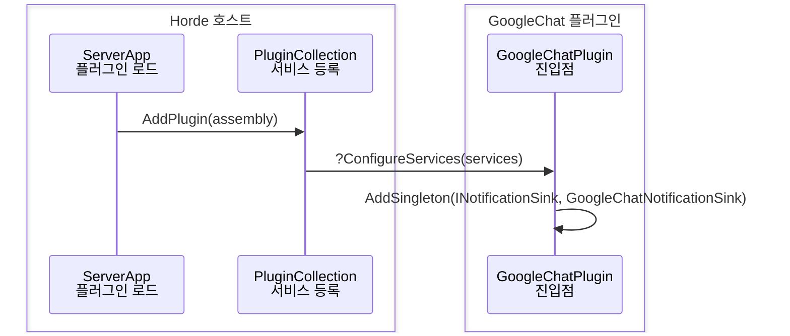
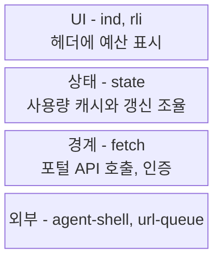

# 다이어그램 (정본)

다이어그램을 그리는 스킬(`explain-change` -> `walkthrough`·`warm-start`, `code-tour`, `improve-codebase-architecture`)이 공유하는 차트 선택과 표기 규칙. 종류를 고정해 그리면 그림마다 답할 질문이 없어지고, flowchart 한 장에 로드 시점과 런타임 흐름이 섞인다. 그래서 **리뷰어 질문 -> 차트**로 고르고, 다른 장이 이미 답한 질문은 그리지 않는다. 스킬 고유 패턴(before/after 대비 등)은 각 스킬에 남긴다.

렌더러는 `~/bin.local/mermaid-cli`의 mmdc 11.17.1(mermaid 11.17.x)로 고정한다. 12는 `-w` 옵션이 없어 ob-mermaid의 `:width`가 깨진다.

## 카탈로그

닫힌 목록. 여기 없는 차트는 쓰지 않는다.

| kind | 차트 | 답하는 질문 | 트리거 |
| --- | --- | --- | --- |
| `tree` | `treeView-beta` | 변경 파일이 저장소 어디에 놓이나 | 신규 파일이 있거나 변경 파일이 2개 이상 디렉터리에 걸침 |
| `overview` | `swimlane-beta TB` | 시점끼리 무엇을 넘기며 이어지나 | 흐름이 2개 이상 시점에 걸침 |
| `sequence` | `sequenceDiagram` | 한 시점 안에서 어떤 순서로 일어나나 | 호출 흐름이 있음. 시점마다 1장 |
| `state` | `stateDiagram-v2` | 어떤 상태를 거치나 | 상태 enum/필드와 그 전이 코드가 추가/변경됨 |
| `er` | `erDiagram` | 설정/데이터는 어떤 모양이고 무엇이 무엇을 참조하나 | 설정/스키마/DTO 모양이 바뀌고 엔티티 2개 이상이 서로 참조 |
| `logic` | `flowchart TD` | 한 함수 안에서 어떻게 판정하나 | 한 함수에 판정 분기 3개 이상이고 sequence `alt`로 담기 어려움 |
| `class` | `classDiagram` | 어떤 추상을 새로 세우나 | 새 인터페이스/기반 클래스 도입, 또는 상속 깊이 2 이상. 기존 계약을 구현만 하면 그리지 않음 |
| `cross-section` | `block-beta` (`columns 1`) | 무엇이 어느 층에 있나 | 계층 지도가 필요한 문서(`code-tour` 단면도, `improve-codebase-architecture`) |
| `module` | `flowchart TD` | 누가 누구에 의존하나 | 명시 요청 전용. 자동 선택하지 않음 |

- **시점**: 같은 시간축에서 일어나는 흐름의 묶음. 예) 로드/등록, 요청 처리, 갱신, 종료.
  - 시점 이름은 그 장의 `title`이 된다.
  - 변경이 닿은 시점만 그린다.
- **1장만 고를 때**(호출자가 `max: 1`): `overview`(시점 2개 이상) > `sequence`(시점 1개) > `tree` > 없음.
- 제외한 것과 이유
  - `architecture-beta` / 경계 `block`: 런타임 경계는 sequence `box`가, 저장소 위치는 `tree`가 답한다.
  - `eventmodeling`, `gantt`, `pie`, `gitGraph`, `timeline`, `mindmap` 등: 코드 이해에 답하는 질문이 없다.
  - `sankey`: 방향과 합계가 있는 차트라 "함께 바뀜"(무방향, 합계 무의미)에 맞지 않는다.
  - `radar`: 축마다 단위가 달라 모양이 쉽게 왜곡된다.
  - `treemap`: "크다"는 보이지만 "나빠지고 있다"는 안 보인다.

## 저장소 진단

한 변경이 아니라 저장소가 나빠지는 곳을 찾는 차트. 재료가 diff가 아니라 git 이력이라 위 카탈로그의 `auto` 대상이 아니다. mermaid는 [smell_map.py](../improve-codebase-architecture/smell_map.py)가 생성하고, 쓰는 쪽은 그대로 싣는다(편집 금지) - quadrant 점 이름 따옴표, 크기, bar 색 같은 표기 함정을 스크립트가 고정한다.

| kind | 차트 | 답하는 질문 | 측정 |
| --- | --- | --- | --- |
| `hotspot` | `quadrantChart` | 크고 자주 바뀌는 파일은 | x = 기간 내 수정 커밋 수, y = 빈 줄 제외 줄 수. 곱 상위 15개, 그 안에서 로그 min-max |
| `co-change` | `flowchart TD` 무방향 | 서로 몰라야 할 파일이 같이 바뀌나 | 다른 디렉터리 쌍, 5회 이상, 결합도 30% 이상. 파일 30개 초과 커밋과 `.h`/`.cpp` 짝 제외 |
| `growth` | `xychart-beta horizontal` bar | 어디가 부풀고 있나 | 기간 끝 - 시작 줄 수, 신규 파일은 0부터. 수정 상위 300개 텍스트 파일 중 상위 10 |

- `co-change` 엣지 의미는 "함께 바뀜" 하나뿐이라 "의존과 흐름을 섞지 않음" 원칙과 충돌하지 않는다.
- 기본 제외: 바이너리(`uasset`, `dll`, `xlsx` 등), 생성 코드(`*.generated.*`, `*Generated.*`), 서드파티/빌드 산출 디렉터리, lock 파일, 데이터(`csv`, `xml`, `xsd`, 로컬라이제이션). 데이터는 `--include-data`로 포함.

## 한 장에 한 관심사

- **flowchart 한 장에 의존과 흐름을 섞지 않는다.** 시간 순서가 있는 관계(호출, 전송, 이벤트, 훅)는 `sequence`로 그린다.
- `module`과 의존 flowchart의 엣지 동사는 정적 의존만: `depends on`, `imports`, `knows`, `uses`, `leaks <무엇>`.
  - `calls`, `sends`, `raises`, `notifies` 같은 흐름 동사가 필요하면 그 그림은 `sequence`다.
- `logic`은 함수 하나의 내부만. 함수 경계를 넘는 화살표가 생기면 `sequence`다.
- `overview`는 시점 간 연결이 요점이다. 시점 안의 세부 호출은 그 시점의 `sequence`에 둔다.

## 공통 표기

- **노드 라벨 = 식별자 + 역할 한 줄.** `<br/>`로 역할을 붙인다. 역할은 이름 풀이가 아니라 책임 서술.
  - flowchart/swimlane/block: `Sel["libre08Shared/WatchWorkoutSelection<br/>워치 운동 선택 정보 공유"]` - `["..."]`로 감싸 `::`·`<>` 등 특수문자에도 구문을 지킨다.
  - sequence: `participant Sel as libre08Shared/WatchWorkoutSelection<br/>워치 운동 선택 정보 공유`
  - class: `class Foo["Foo<br/>역할"]`
  - tree: `파일명 ## 역할`
- **엣지 라벨 = 관계 동사.** 무라벨 엣지는 "뭔가 연결돼 있다"까지만 읽힌다.
- **추정은 선 모양이 아니라 라벨 앞 `?`로.** 선 모양에는 이미 관계 의미가 걸려 있다(class `..>` = UML 의존, sequence `-->>` = 응답). grep/read로 확인한 것만 무표시.
  - flowchart/swimlane: `PCM -->|?sends| Sel`
  - class: `Workout ..> Selection : ?creates`
  - sequence: `CV ->> WCM: ?chooseExercise(offset:)`
- **캡션 범례는 조건부.** 추정 엣지가 하나라도 있을 때만 "?=추정"을 넣는다.
- **추정이 전체 엣지의 1/3을 넘으면 그대로 내지 않는다.** 더 확인하거나, 확인 못 한 엣지는 빼고 캡션에 "관계 N개 미확인"을 적는다.
- **변경 노드는 하이라이트.** `classDef changed fill:#ffe9a8,stroke:#c08a00` + `class <Id> changed`. `class` 지정은 노드 하나당 한 줄 - `class A,B changed`는 무효 구문.
  - tree는 `파일명 :::highlight` (`:::` 앞 공백 필수).
  - sequence는 하이라이트가 없다. 변경 participant를 `box`로 묶는다.
- **노드 상한 ~15.** 넘으면 가장 먼 홉, 변경과 무관한 잎부터 가지치기하고 캡션에 "외 N개 생략".
- **유효 엣지가 0이면 그리지 않는다.** 빈 다이어그램 금지(`tree`·`cross-section`은 노드만으로 성립).
- 방향은 `TD`/`TB` 고정 - `LR`은 고정 폭 렌더에서 글자가 작아진다.

## 문법 예시

### tree


- 변경 파일과 그 파일을 이해하는 데 필요한 이웃 파일만. 저장소 전체를 펼치지 않는다.

### overview

```mermaid
swimlane-beta TB
  subgraph load [로드/등록]
    scan["ServerApp<br/>플러그인 DLL 로드"]
    reg["GoogleChatPlugin<br/>ConfigureServices"]
  end
  subgraph run [config 갱신 전송]
    fan["NotificationService<br/>sink 팬아웃"]
    send["GoogleChatWebhookSender<br/>webhook POST"]
  end
  scan -->|loads| reg
  fan -->|calls sink| send
  reg -->|registered sink| fan
  classDef changed fill:#ffe9a8,stroke:#c08a00
  class reg changed
  class send changed
```

- lane = 시점, lane 순서 = 시간 순서.
- 노드는 굵은 단계만. lane을 넘는 엣지 라벨은 앞 시점이 넘기는 것(등록된 객체, 바인딩된 설정 등).
- 노드는 lane 하나에만 속한다. 같은 노드를 두 lane에 쓰지 않는다.

### sequence



- 시점 하나에 1장. 소유 경계(호스트/플러그인/외부)는 `box`로 묶는다.
- 분기는 `alt`/`else`, 반복은 `loop`.

### cross-section



- 위가 사용자 쪽, 아래가 외부 쪽. 화살표를 그리지 않는다 - 흐름은 `sequence` 몫.

`state`·`er`·`logic`·`class`·`module`은 mermaid 표준 문법 그대로 쓰고 위 공통 표기만 지킨다.

## org 렌더

- org mermaid 블록: `#+begin_src mermaid :file <경로>.png :width "2048"`. `:width "2048"`으로 폭 통일.
- `:file` 이름에 kind를 넣는다. `sequence`가 여러 장이면 시점 slug를 붙여 겹치지 않게 한다(`<slug>-sequence-load.png`).
- 렌더는 온디맨드 - 사용자가 `C-c C-c`/export로 PNG를 만든다(pre-render하지 않는다).
